# Lab Sheet 3 : answers

**Team :** Nasri ahmed, Ferg Mohamed El'Amine, Bouziane Chakib, Abdi Ahmed Raed

> Screenshots of every command (command + full output) are in [`docs/TP03_screenshots/`](TP03_screenshots/).

---

## Part A: Multi-stage image

**Files created:** `Dockerfile` and `.dockerignore`

**First build:** all 17 steps finished.

### Exercise 1:

**Image sizes:**

- **(a).** `scoreboard:local` is **181MB** and `python:3.12-slim` is **119MB**.

**Second build, after changing one byte of `src/scoreboard/app.py`:**

**`git checkout` restored the file, only the new files remain:**

**What is inside the runtime image:**

- **(b).** Two things are in the build stage but not in the runtime image: (1) the source tree `/app/src`, and (2) the build files (`requirements.txt`, `pyproject.toml`, `README.md`). The runtime stage only copies `/opt/venv` and `data/`. The screenshot above shows that only `data` is in `/app`.

- **(c).** Without the source tree, an attacker inside the container cannot read or edit the unbuilt code to look for weak spots or secrets. Without the build files, the exact dependency list and versions are not handed to the attacker to look up known vulnerabilities. In both cases, fewer files in the image means a smaller attack surface.

- **(d).** `COPY requirements.txt` comes before `COPY src/` so the dependency install layer stays cached when only the code changes. In the second build, the steps up to `COPY pyproject.toml README.md` said `CACHED`, including `pip install -r requirements.txt`. The rebuild started at `COPY src/`. If `src/` came first, every code change would reinstall all the dependencies.

---

## Part B: Run it with the minimum it needs

**Hardened container started:**

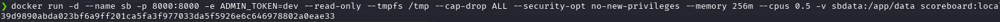

**Smoke test (all 12 checks passed):**

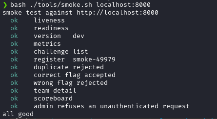

**Container user and read-only filesystem:**

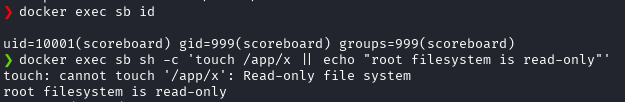

### Exercise 2:

- **(a).** The named volume mounted at `/app/data` (`-v sbdata:/app/data`). It is the only writable place for the SQLite database, while `--tmpfs /tmp` gives a writable memory area for temporary files. Everything else stays read-only, as the `touch` test shows.

- **(b).** A named volume is managed by Docker and is initialised from the image's `/app/data`, which is owned by uid 10001, so the non-root user can write to it. The host folder `$PWD/data` belongs to the host user, so uid 10001 would get "permission denied". It would also expose the host's files to the container and depend on the host's path.

- **(c).** `--cap-drop ALL`: the attacker can no longer use Linux capabilities, for example change file owners, open raw network sockets or bind ports below 1024.
`--security-opt no-new-privileges`: the attacker can no longer gain extra privileges by running a setuid binary.

---

## Part C: Who receives SIGTERM?

**`docker stop sb` (uvicorn is PID 1):**

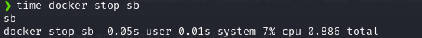

**`sb2` (a shell is PID 1), its command line and `docker stop sb2`:**

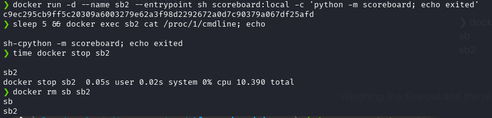

### Exercise 3:

- **(a).** `docker stop sb` took **0.886 s**. `docker stop sb2` took **10.390 s**.

- **(b).** `docker stop` sends SIGTERM to PID 1 and waits 10 s, then sends SIGKILL. In `sb`, uvicorn is PID 1: it handles SIGTERM, finishes its in-flight requests and exits at once. In `sb2`, the `sh` shell is PID 1 (see `/proc/1/cmdline`). A PID 1 process has no default action for signals, and `sh` does not forward SIGTERM to its child `python`, so nothing stops until the 10 s timeout. Then SIGKILL kills everything.

- **(c).** With twenty replicas replaced one after the other, the slow case costs about 20 x 10.4 s = **208 s** instead of about 20 x 0.9 s = **18 s**, so the rollout is more than 10 times slower. Each SIGKILL also cuts the requests still in progress, and can leave a SQLite write half-done.

---

## Part D: Scan the image

**Image saved to a tar file:**

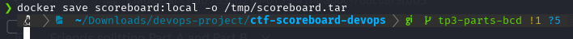

**Trivy report summary:**

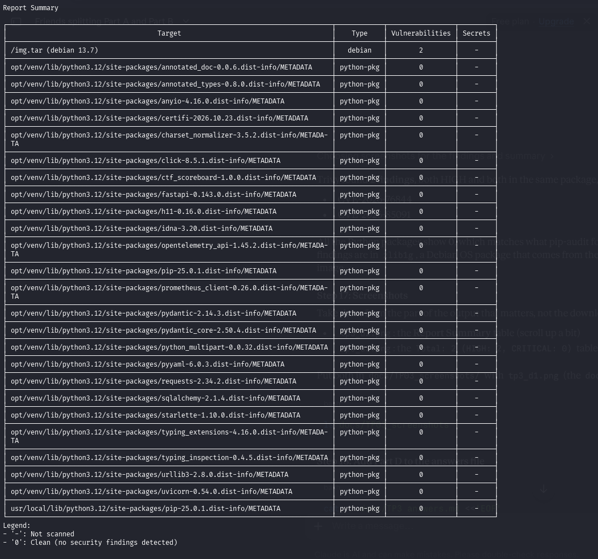

**Trivy findings (HIGH and CRITICAL, fixed only):**

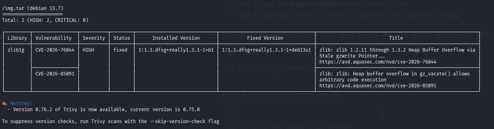

### Exercise 4:

- **(a).** There are **2 findings**, both HIGH and none CRITICAL. Both are in the package `zlib1g` (Debian 13.7): `CVE-2026-76844` and `CVE-2026-85091`. They are heap buffer overflows in zlib, and a fixed version exists (`1:1.3.dfsg+really1.3.1-1+deb13u1`). All the Python packages in `/opt/venv` have 0 findings.

- **(b).** `pip-audit` only checks the Python packages of the application against the Python advisory database, and it found nothing. Trivy scans the whole image, including the Debian operating system packages that come from the `python:3.12-slim` base image. `zlib1g` is one of those OS packages, so `pip-audit` could never see it.

- **(c).** A fixed version makes the scan reproducible: the same image gives the same result, with no surprise from a new scanner release. It also avoids pulling a moving tag that could change or be compromised (supply chain risk).

---

## Part E: Build and publish from the pipeline

**The `image` job added to `.github/workflows/ci.yml` (jobs `verify` and `image`):**

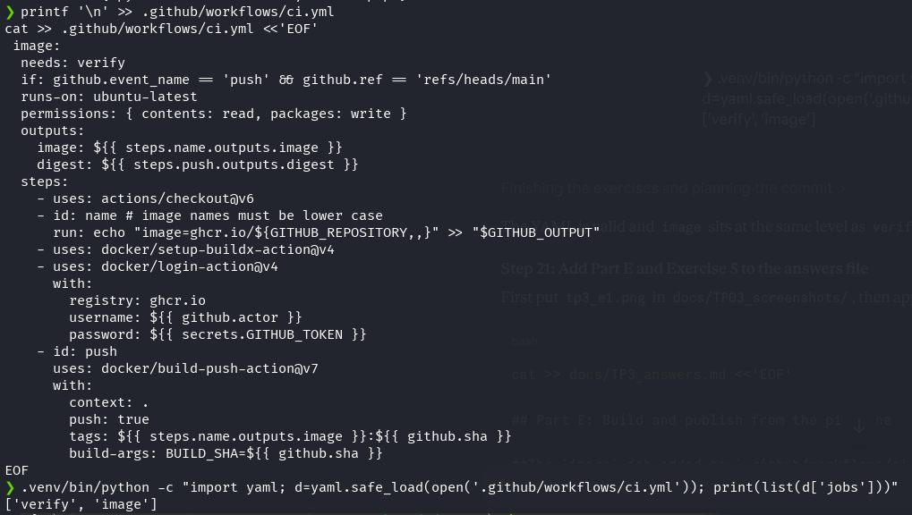

The job runs only after `verify` passes (`needs: verify`) and only on a push to `main` (never on a pull request).

### Exercise 5:

- **(a).** The commit identifier travels through these steps: the Git commit -> `github.sha` in the workflow -> `build-args: BUILD_SHA=${{ github.sha }}` in the `build-push-action` -> `ARG BUILD_SHA` in the Dockerfile -> `ENV BUILD_SHA` in the image -> read by the running application -> returned by `/version`. The same sha is also used as the image tag.

- **(b).** `latest` is a mutable tag: it does not say which code is inside the image. With two versions running at the same time, you cannot tell which replica runs which version, and a node that cached an older `latest` keeps running the old code while a new node pulls the new one, so both "versions" can silently be the same or different. A rollback is also impossible, because the previous image no longer has a name that points to it.

---

## Part E results

**Pipeline run on `main`: `verify` then `image`, both green:**

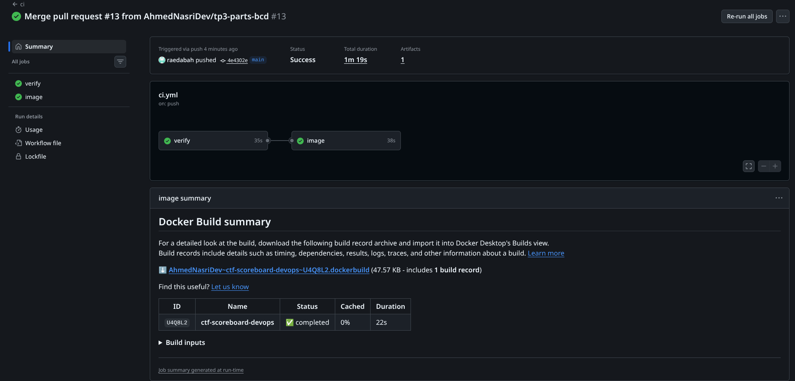

**Package `ghcr.io/ahmednasridev/ctf-scoreboard-devops`, **Public**, tagged with the full commit hash:**

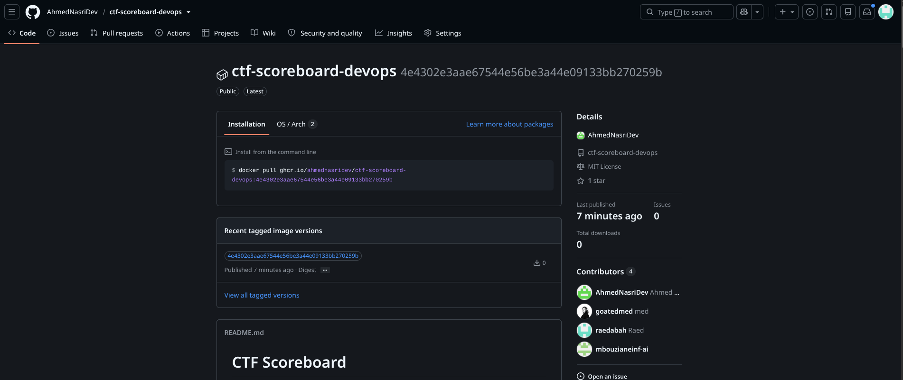

**Pull and run of the published image, `/version` shows the same commit hash:**

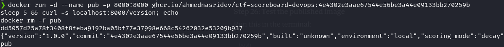
