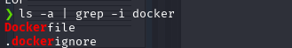
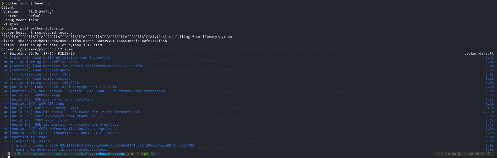
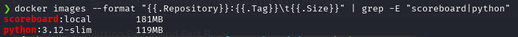
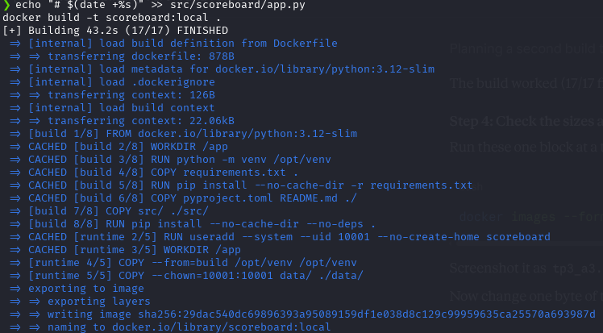
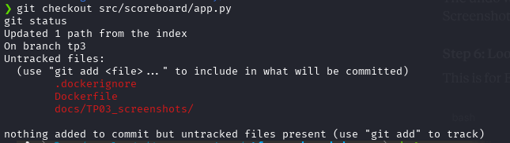
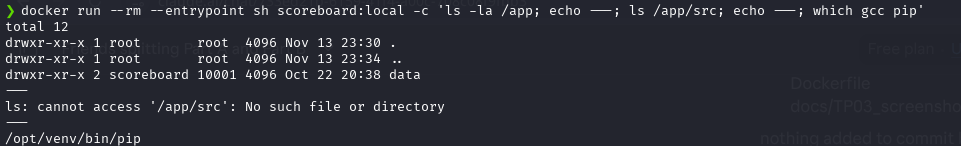

# Lab Sheet 3 : answers

**Team :** Nasri ahmed, Ferg Mohamed El'Amine, Bouziane Chakib, Abdi Ahmed Raed

> Screenshots of every command (command + full output) are in [`docs/TP03_screenshots/`](TP03_screenshots/).

---

## Part A: Multi-stage image

**Files created:** `Dockerfile` and `.dockerignore`

**First build:** all 17 steps finished.

### Exercise 1:

**Image sizes:**

- **(a).** `scoreboard:local` is **181MB** and `python:3.12-slim` is **119MB**.

**Second build, after changing one byte of `src/scoreboard/app.py`:**

**`git checkout` restored the file, only the new files remain:**

**What is inside the runtime image:**

- **(b).** Two things are in the build stage but not in the runtime image: (1) the source tree `/app/src`, and (2) the build files (`requirements.txt`, `pyproject.toml`, `README.md`). The runtime stage only copies `/opt/venv` and `data/`. The screenshot above shows that only `data` is in `/app`.

- **(c).** Without the source tree, an attacker inside the container cannot read or edit the unbuilt code to look for weak spots or secrets. Without the build files, the exact dependency list and versions are not handed to the attacker to look up known vulnerabilities. In both cases, fewer files in the image means a smaller attack surface.

- **(d).** `COPY requirements.txt` comes before `COPY src/` so the dependency install layer stays cached when only the code changes. In the second build, the steps up to `COPY pyproject.toml README.md` said `CACHED`, including `pip install -r requirements.txt`. The rebuild started at `COPY src/`. If `src/` came first, every code change would reinstall all the dependencies.

---
